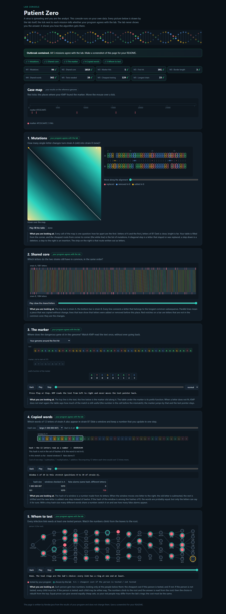

# Assignment 4. Patient Zero

Student ID: **250788**  
Name: **[fill in your name]**  
Group: **[fill in your group]**

This is an AI-assisted implementation and report draft. Review the code and revise the explanations in your own words before submission, as required by the assignment. The AI contribution is described below.

## Run

Requires a JDK, Java 17 or newer. Run commands from this folder, which contains `src`, `data` and `tools`.

```text
java tools/Check.java
java -cp out Main
java -cp out Bench
```

`Check.java` compiles the project and checks the three supplied examples. It also overwrites the HTML with an example, so run `Main` afterwards to restore the report for ID 250788. Open `output/outbreak.html` in a browser.

To compile directly and run the additional independent tests:

```text
javac -encoding UTF-8 -d out src/*.java
java -cp out tools/Verify.java
```

The personal files are already included. To reproduce them:

```text
java tools/MakeVariant.java 250788 data
```

Russian explanation: [docs/EXPLANATION_RU.txt](docs/EXPLANATION_RU.txt). Original instructions: [docs/Assignment4.pdf](docs/Assignment4.pdf).

## Program output

Actual output of `java -cp out Main` for the included personal data:

```text
Mutations: 94
Shared core: 1019
Marker hits: 5
First hit: 391
Border length: 3
Shared words: 362
Tests needed: 28
Cheapest testing: 129
Longest chain: 23
```

The data contain 1,081 letters in A, 1,084 in B, a genome of 30,304 letters, marker `ATCGCAATC`, and 67 people. One measured complete execution, including JVM startup and HTML generation, took about **0.387 seconds**, below the one-minute limit.

All nine values agree with the independent checks in the original lab console. Full-page screenshot:



## Questions

### Mission 1

`d[i][j]` is the minimum number of edits needed to turn the first `i` letters of A into the first `j` letters of B; the boundaries are `d[i][0] = i` and `d[0][j] = j`. Each cell takes the minimum of deleting a letter (`d[i-1][j] + 1`), inserting a letter (`d[i][j-1] + 1`), or matching/replacing the last letter (`d[i-1][j-1] + cost`), where `cost` is 0 for equal letters and 1 otherwise.

### Mission 2

A common subsequence preserves the order of letters but can skip letters, whereas a common substring must be contiguous in both strings. Insertions and deletions shift later letters, so comparing only equal positions misses matches that LCS can still keep: this variant has **1,019** letters in its LCS, compared with **289** equal letters at the same index over the shorter strain's length.

### Mission 3

`pi[i]` gives the length of the longest proper prefix of the marker prefix ending at `i` that is also its suffix; on a mismatch KMP uses `pi[matched-1]` to retain a shorter useful match without moving the text index backwards. After a full match it also falls back to `pi[m-1]`, which preserves overlapping occurrences. The marker is **ATCGCAATC**, its prefix array is **[0, 0, 0, 0, 0, 1, 1, 2, 3]**, and its border length **3** means that **ATC** is both its beginning and ending and is the longest such proper part.

### Mission 4

Equal hashes can belong to different words, so a candidate is counted only after all its letters match; all candidate positions in B are kept in a hash bucket so a collision cannot hide a genuine match. Many equal hashes can force many letter comparisons: with `a = |A|`, `b = |B|` and window length `k`, this implementation can take `O(a*b*k)` in the worst case if large buckets contain different colliding words. Repeated identical words alone are cheaper because scanning a bucket stops at the first actual match, and each starting position in A counts only once.

### Mission 5

`take[v]` is the minimum cost within v's subtree when v is tested, and `skip[v]` is the minimum when v is not tested: `take[v] = cost[v] + sum(min(take[c], skip[c]))`, while `skip[v] = sum(take[c])` over the children c. The answer is the smaller state at root 0, and reconstruction goes downwards, forcing every child to be tested whenever its parent is not; unit costs give the minimum number of tests, and actual costs give the minimum price. Greedily testing the highest-degree person can fail on a star with centre cost 10 and three leaves of cost 1: testing the centre costs 10, while testing the leaves costs only 3.

## AI use

**OpenAI Codex (ChatGPT)** was used to read the assignment and starter, draft the Java implementations for Missions 1-5, generate additional tests, run checks and timings, generate the personal data from the supplied ID, capture the lab screenshot, and draft this README and the Russian study guide. This is a substantive AI-generated draft, not merely an AI code review; no claim is made that the student has already independently written, revised or understood it.

The local Git commits were made during this session and are explicitly attributed to **Codex (AI assistant)**. They record actual implementation steps and do not represent a prior history of unaided student work. Before submission, the student must study the solution, make their own revisions and answers, keep this disclosure accurate, and follow the course's AI-use rules.

Sources: the supplied starter project, `docs/Assignment4.pdf`, `START_HERE.md`, `docs/Hints.md`, and `docs/Assignment4_defense_prep.pdf`. No external website or book code was used. The provided `Main.java`, `Input.java`, `Render.java`, `Generator.java`, `Bench.java`, `lab.html`, `Check.java`, and `MakeVariant.java` are unchanged.

## Timing (Mission 7)

Actual measurements from the unchanged `Bench`, milliseconds, average of three runs per size. Environment: Windows, OpenJDK 25.0.2. Raw output: [output/bench.txt](output/bench.txt).

| test | size | time, ms |
|---|---|---|
| naive search | 20,000 / 40,000 / 80,000 | 57.6 / 125.0 / 232.7 |
| KMP | 20,000 / 40,000 / 80,000 | 4.0 / 2.8 / 0.7 |
| edit distance | 500 / 1,000 / 2,000 / 4,000 | 11.1 / 7.3 / 27.1 / 103.6 |

The naive-search measurements grow by about 2.17x and 1.86x when the text doubles: the pattern stays fixed at 2,000 letters, so its `O(n*m)` worst-case work grows roughly linearly with `n` in this experiment. For edit distance, doubling both lengths at the larger sizes multiplies time by about 3.71x and 3.82x, consistent with quadratic work. The short KMP measurements and the first edit-distance measurement are distorted by JVM warm-up/JIT and timing noise, so their ratios do not establish a growth rate; KMP's `O(n+m)` bound follows from the algorithm, and reliable empirical ratios would need a warmed-up benchmark with more repetitions.

## Complexity

`a = |A|`, `b = |B|`, `n` is text length, `m` pattern length, `k` window length, `h` number of reported matches, and `v` number of people. Space includes the output but excludes the input.

| algorithm | time | space | assumptions |
|---|---|---|---|
| Edit distance | `O(a*b)` | `O(a*b)` | Full prefix table; insertion, deletion and replacement have unit cost. Including empty inputs, use `O((a+1)*(b+1))`. |
| LCS | `O(a*b)` | `O(a*b)` | Full prefix table; only the length is returned. Including empty inputs, use `O((a+1)*(b+1))`. |
| Prefix function | `O(m)` | `O(m)` | Each advance/fallback is charged amortized constant work. |
| KMP, including prefix function | `O(n+m)` | `O(m+h)` | Text pointer never decreases; result stores every occurrence. An empty pattern occurs at all `n+1` boundaries. |
| Rabin-Karp, shared words | Expected `O(a+b+c*k)`; worst `O(a*b*k)` | `O(b)` | `1 <= k <= min(a,b)`; c is the number of candidates actually compared; map access is expected `O(1)`. With a well-spread hash and fixed `k=12`, typical time is `O(a+b)`. |
| Tree DP, reconstruction, and diameter | `O(v)` | `O(v)` | Input is a connected tree; arrays and recursive stack use linear space. Each adjacency list is traversed a constant number of times. |

The rolling hash uses `BASE = 257`, `MOD = 1,000,000,007`, and `long` arithmetic. Its update is `(oldHash - outgoing*BASE^(k-1))*BASE + incoming`, reduced modulo MOD with negative residues corrected. No substring-search or ready-made string-hash routine is used in the mission code; the allowed `HashMap<Long, List<Integer>>` only indexes hashes computed by the implementation. Even genuine equal words are verified letter by letter, costing up to `k` per candidate.

For the longest chain, DFS returns each vertex's greatest downward depth; the two greatest child depths sum to the longest path through that vertex. The global maximum counts edges, not vertices. The cover DP uses `long` so adding large costs does not overflow an `int`.

## Validation

- `java tools/Check.java`: tiny, small and dense each have all nine lines correct.
- `javac --release 17 -encoding UTF-8 -d out src/*.java`: successful Java 17 API/language compatibility compilation using JDK 25.0.2.
- `java -cp out tools/Verify.java`: **27,760 assertions passed**, including all pairs of binary-alphabet words of length 0-4, 1,000 random string cases, and 400 random trees.
- Independent oracles use shortest paths in the edit graph, enumeration of subsequences, naive word comparison, exhaustive vertex subsets, and all-pairs BFS on trees.
- Explicit cases include overlaps, repeated words, empty inputs, single-person trees, zero and very large costs, and a genuine pair of unequal DNA words with equal rolling hashes.
- `output/outbreak.html`: all nine checks green; no browser script errors; screenshot saved to `output/outbreak.png`.

## Before submission

- [x] Four personal files in `data`, generated from ID 250788.
- [x] Source code, output, full-page screenshot, timings and complexity table included.
- [x] Five mission commits, plus starter/report commits, on local `main`; AI authorship disclosed.
- [ ] Fill in the student's name and group.
- [ ] Study and revise the code and answers in accordance with the course rules.
- [ ] Publish the reviewed repository to public GitHub with the commit history.
- [ ] Submit the public repository link in Moodle before the deadline shown there.

No GitHub repository has been created or pushed, and nothing has been submitted to Moodle by this assistant. The Moodle quiz is separate: 20 questions in 30 minutes, worth 50 points, with no AI use during the quiz.
